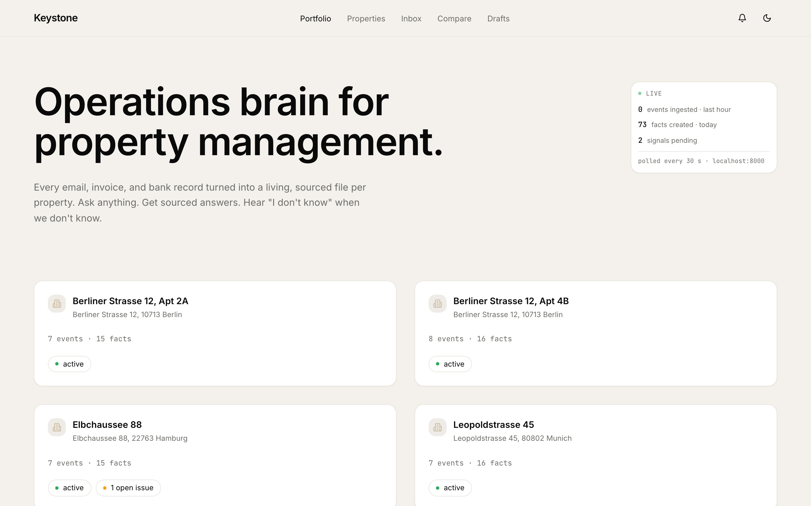
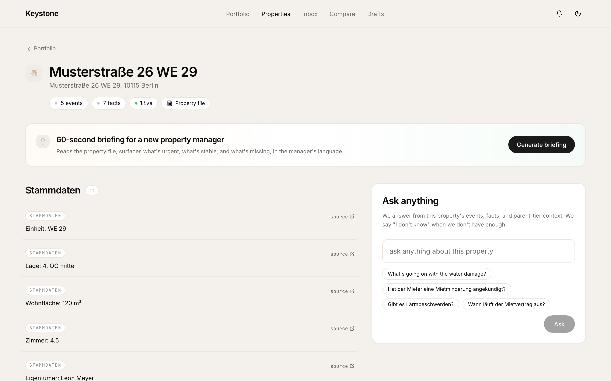
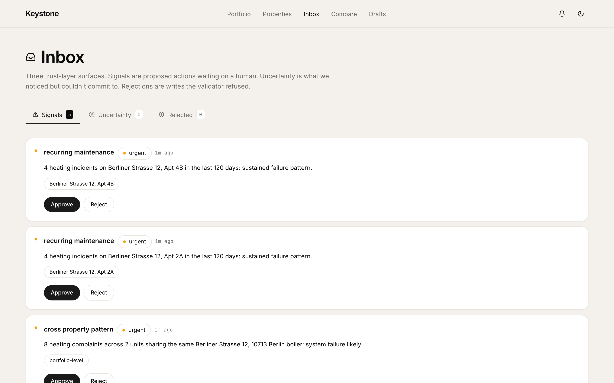
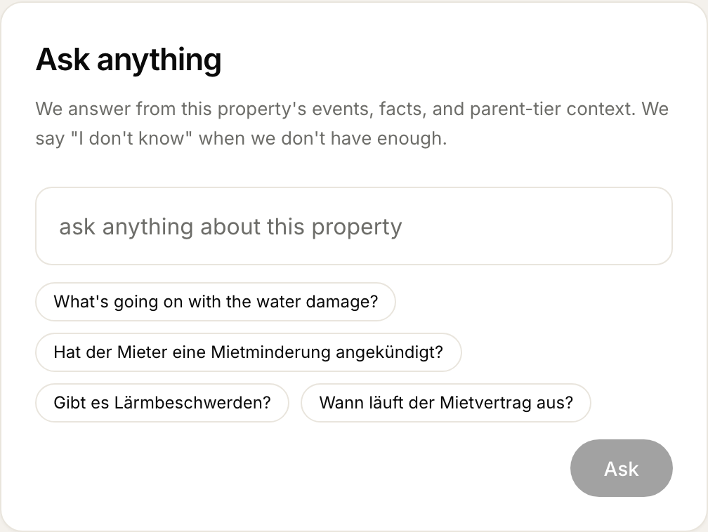
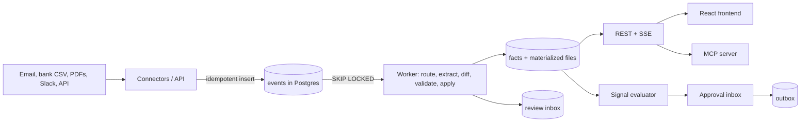

# Keystone

Keystone turns a property manager's scattered inbox, bank statements,
invoices and master data into one current, sourced file per property. Every
fact links to the email or document it came from, carries a confidence score
and keeps its history; anything the system is unsure about goes to a review
inbox instead of into the file. On top of the files, rules raise signals
(recurring heating failures, expiring leases, patterns across buildings) that
a human approves before anything is sent. It runs without any API key, using a
rule-based extractor.

Built solo in a hackathon window, then cleaned up and hardened.

| Portfolio | Property file |
|---|---|
|  |  |
| **Approval inbox** | **Ask** |
|  |  |

The `docker compose` stack with no API key, after five synthetic tenant emails
were sent to WE 29 through `POST /debug/trigger_event` (see Quickstart).

## How it works



Design details: [docs/ARCHITECTURE.md](docs/ARCHITECTURE.md). Why it is built
this way, including the mistakes: [docs/DECISIONS.md](docs/DECISIONS.md).

## Features

- **Idempotent ingestion** of `.eml` archives, bank CSV, invoice and letter
  PDFs, master data, IMAP, Slack and PDF upload, keyed on
  `(source, source_ref)`: `connectors/`, `backend/api/webhooks.py`,
  `backend/api/uploads.py`
- **Postgres as the job queue** with `FOR UPDATE SKIP LOCKED`, one transaction
  per event: `backend/pipeline/worker.py`
- **Three-tier routing** (owners' association, building, unit) that leaves an
  event unrouted rather than guessing: `backend/pipeline/router.py`
- **LLM extraction with structured output**, timeouts, retries and a
  rule-based fallback: `backend/pipeline/extractor.py`,
  `backend/services/gemini.py`
- **Facts with provenance and supersession**, where operator edits are never
  overwritten: `backend/pipeline/differ.py`, `backend/pipeline/applier.py`
- **Trust layer**: 8 rule constraints, an LLM contradiction check and an
  uncertainty inbox: `backend/pipeline/validator.py`,
  `backend/pipeline/constraints/`, `backend/pipeline/semantic_validator.py`
- **Per-property files re-rendered in the same transaction** as each fact
  write: `backend/pipeline/materializer.py`
- **Signals with human approval**; a decision holds for a cooldown period:
  `backend/signals/`, `backend/api/signals.py`
- **Ask a property** with cited answers or an explicit "I don't know":
  `backend/services/ask.py`
- **MCP server** exposing property context to MCP clients: `mcp_server/`
- **PII redaction at ingestion** and a **durable LLM spend cap**:
  `connectors/redact.py`, `connectors/cost_ledger.py`
- **Evaluation harness** with committed run reports: `eval/`, `docs/eval-runs/`

## Quickstart

Requires Docker.

```bash
cp .env.example .env && docker compose up
```

- Frontend: <http://localhost:8080>
- API and interactive docs: <http://localhost:8000/docs>

The first start builds both images, applies the schema and loads synthetic
sample data: 56 properties, and six tenant emails for the featured property
(WE 29) that go through the pipeline so its file has a history. No API key is needed: extraction falls back to
the rule-based extractor and signal drafts to templates. Ask, reply drafting
and the LLM contradiction check need a provider key in `.env`:
`GEMINI_API_KEY` by default, or `LLM_PROVIDER=pioneer` with `PIONEER_API_KEY`.
Push an event through the pipeline:

```bash
curl -X POST localhost:8000/debug/trigger_event -H 'content-type: application/json' \
  -d '{"raw_content": "From: tenant@example.com\nSubject: Heizung\n\nDie Heizung in WE 29 ist ausgefallen."}'
```

Development without containers: `docker compose up -d postgres`, then
`pip install -e ".[dev]"` and `./scripts/dev.sh` (API with reload plus the Vite
dev server). Tests: `pytest` against that Postgres, with no keys or other
services, and `npm test` in `frontend/`. `pre-commit install` adds ruff,
prettier and a check that blocks real addresses, IBANs and deployment URLs;
CI (`.github/workflows/ci.yml`) runs those plus mypy, ESLint, the type check,
both test suites and the frontend build.

## Evaluation

30 hand-labelled emails, scored by `python -m eval.runner --set emails_v1`.
Full methodology and weaknesses: [docs/EVALUATION.md](docs/EVALUATION.md).

| Metric | LLM (Gemini) | Rule-based, no key |
|---|---:|---:|
| Category accuracy | 73.3% | 63.3% |
| Routing accuracy | 93.3% | 93.3% |
| Fact extraction, micro F1 | 0.88 | 0.42 |
| Lease facts, F1 | 0.62 | 0.67 |
| Extracted values matching the source wording | 3 of 26 | 0 of 11 |

Every number here is traced to its command or report in
[docs/PROJECT_FACTS.md](docs/PROJECT_FACTS.md).

## Tech stack

Python 3.11, FastAPI, SQLAlchemy 2 (async, asyncpg), PostgreSQL, APScheduler,
pydantic, structlog; Google Gemini and an OpenAI-compatible gateway for LLM
calls; MCP Python SDK. Frontend: React 18, TypeScript, Vite, TanStack Query,
Tailwind CSS, Radix UI. Tooling: pytest and pytest-asyncio, Vitest and
Testing Library, ruff, mypy (strict), ESLint, Prettier, pre-commit, GitHub
Actions.

## Project layout

```
backend/        FastAPI app: api/, pipeline/, signals/, services/, db/
connectors/     archive importers, PII redaction, cost ledger, CLI
eval/           ground truth, runner, metrics
mcp_server/     MCP adapter over the REST API
frontend/       React client
seed/           sample data and schema bootstrap
scripts/        dev runner, backfill, demo-data synthesis, release checks
tools/mock_erp/ optional stand-in ERP feed
docs/           architecture, decisions, evaluation, facts, release, eval runs
Extracted_demo/ synthetic master data (committed)
```

## Limitations

No authentication; approved actions are written to an outbox, never sent;
scheduled jobs run in every API instance, so several instances repeat the
same work; extraction quality is measured on only 30 emails. The full list is in
[docs/ARCHITECTURE.md](docs/ARCHITECTURE.md#known-limitations).

## License

MIT, see [LICENSE](LICENSE).
