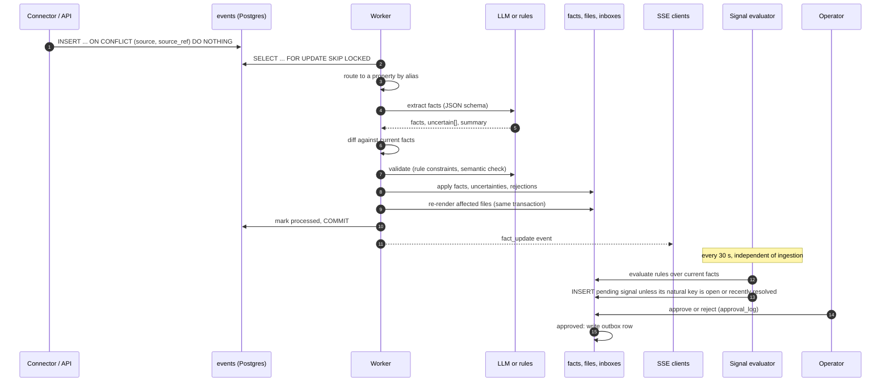

# Architecture

This document explains how Keystone is put together and why. It describes the
code as it is; where behaviour is incomplete or surprising, the
[Known limitations](#known-limitations) section says so. Individual design
decisions, with the alternatives that were rejected, are recorded in
[DECISIONS.md](DECISIONS.md).

## Problem

A property manager's knowledge about a building is scattered across email
threads, bank statements, contractor invoices, letters and master-data
spreadsheets. Answering a simple question ("is the water damage in unit 29
fixed, and has the tenant reduced the rent because of it?") means reading
through all of them.

Keystone ingests those sources, extracts structured facts, and keeps one
current, sourced file per property. On top of that file it raises signals
(patterns worth acting on) that a human approves or rejects. The design goals,
in priority order:

1. **Every claim is traceable.** Each fact links to the event it came from and
   carries a confidence score and a validity interval.
2. **The system says when it does not know.** Low-confidence or contradictory
   extractions go to a review inbox instead of into the file.
3. **Nothing leaves the system without a human.** Signals propose actions;
   only an approval writes to the outbox.
4. **It runs without any API key.** Every LLM-backed step has a deterministic
   fallback or degrades to an explicit notice.

## System overview

| Component | Path | Role |
|---|---|---|
| REST API | `backend/main.py`, `backend/api/` | FastAPI app: properties, files, signals, admin inboxes, SSE |
| Event worker | `backend/pipeline/worker.py` | Claims events from Postgres and runs the pipeline |
| Pipeline stages | `backend/pipeline/` | Router, extractor, differ, validators, applier, renderer, materializer |
| Signal system | `backend/signals/` | Rules, evaluator, drafter |
| Scheduler | `backend/scheduler.py` | APScheduler jobs inside the API process |
| Connectors | `connectors/` | Customer-agnostic ingestion: `.eml`, bank CSV, invoice and letter PDFs, master data |
| MCP server | `mcp_server/` | Exposes property context to MCP clients over the REST API |
| Evaluation | `eval/` | Ground truth, runner and metrics for the extractor |
| Frontend | `frontend/` | Vite + React client for the API |

Postgres is the only stateful dependency. It stores the data, acts as the job
queue and holds the LLM spend ledger.

## Data model

The base schema is `backend/db/schema.sql`; later additions are additive
migrations in `connectors/migrations.py` (`0001` to `0013`), applied in order
and safe to re-run.

### Events

`events` is the append-only record of everything that arrived: an email, a bank
row, an invoice PDF, a Slack message, a manually injected test event. Each row
holds `source`, `source_ref`, `raw_content`, `metadata`, `received_at`, and the
processing outcome (`processed_at`, `processing_error`).

`UNIQUE (source, source_ref)` makes ingestion idempotent. Every connector
derives a stable `source_ref` from its input, so re-running an import inserts
nothing new:

| Source | `source_ref` |
|---|---|
| Email (`.eml`, IMAP) | `Message-ID`, falling back to a hash of From, Date and Subject |
| Bank row | hash of date, amount, purpose text and account reference |
| Invoice or letter PDF | `<filename>:<sha256(file bytes)[:16]>` |
| Master-data row | natural key (ID column) |

Events that fail repeatedly are tracked in `failed_events` with a retry count,
so a poison message is dead-lettered instead of retried forever.

### Facts: provenance, confidence, supersession

`facts` holds the extracted knowledge as `(section, field, value)` rows, for
example `(maintenance, open_water_issue, "Leak in the kitchen ceiling since 23
April")`. Every row carries:

- `source_event_id`: the event the fact was extracted from.
- `confidence`: the extractor's score in `[0, 1]`.
- `valid_from` / `valid_to` and `superseded_by`: when a newer fact replaces an
  older one, the old row is kept and points at its successor. Nothing is
  deleted, so the history of any field can be reconstructed.
- `human_edited`, `edited_by`, `edited_at`: an operator correction made via
  `PATCH /properties/{id}/facts/{fact_id}`. The differ never lets an extracted
  proposal overwrite a human edit.

The partial index `idx_facts_current ... WHERE superseded_by IS NULL` makes
"current facts for this property" a single index scan.

### Three-tier hierarchy: Liegenschaft, building, property

German residential property management has three levels of ownership:

```
Liegenschaft (WEG, the owners' association)
  └── Gebäude (building, "Haus")
        └── Einheit (unit, a "property" in this codebase)
```

The sample dataset is one Liegenschaft with three buildings and 52 units.
Costs such as the shared management fee or a contractor invoice for the
staircase belong to the Liegenschaft, a roof repair belongs to a building, and
rent belongs to a unit. Attributing a WEG-level invoice to one unit would
corrupt that unit's financials, so `events` and `facts` carry
`property_id`, `building_id` and `liegenschaft_id`, with exactly one set once
an event is routed. A property's file includes the recent activity of its
building and Liegenschaft as context sections.

### Materialized files

`property_files`, `building_files` and `liegenschaft_files` hold the rendered
markdown for each scope, plus `trigger_event_id`, `trigger_summary` and
`last_rendered_at`. Every fact write re-renders the affected files **in the
same transaction** (`backend/pipeline/materializer.py`):

- a property fact refreshes that property's file;
- a building fact refreshes the building's file and every property under it;
- a Liegenschaft fact refreshes the Liegenschaft, its buildings and all their
  properties.

A file is therefore never stale relative to the facts it is rendered from, and
`GET /property_files/changes?since=...` can serve a "what changed" feed. The
renderer (`backend/pipeline/renderer.py`) is deterministic and makes no LLM
calls, so re-rendering costs no spend.

### Signals and the approval log

`signals` holds proposed actions: `type` (the rule that fired), `severity`,
`message`, `evidence` (the events and facts behind it), `proposed_action` (a
drafted message and recipient) and `status` (`pending`, `resolved` after
approval, `rejected`). `natural_key`
(`type|property id or 'portfolio'|subtype`) identifies "the same finding"
across evaluator runs; see [Signals](#signals).

`approval_log` records every human decision: signal approvals, rejections and
edits, and trust-layer actions such as overriding a rejected update or
resolving an uncertainty (`actor`, `action`, `target_type`, `target_id`,
`payload`). One audit table answers "who decided what, and when".

`outbox` receives the message for every approved signal. Nothing is sent
externally; see [Known limitations](#known-limitations).

### Trust tables

- `uncertainty_events`: observations the system could not commit to as facts
  (low confidence, ambiguous, or flagged by a validator as needing review),
  with a hypothesis and the reason. Resolved by promoting to a fact or
  dismissing.
- `rejected_updates`: proposed facts that a validator rejected, with the
  constraint name, the reason and, where relevant, the document type that
  would have been accepted.

### Cost ledger

`cost_ledger` stores cumulative LLM spend per label against a cap. Every
extraction during a backfill charges it; when a charge would exceed the cap the
run stops, and later runs refuse to start until the cap is raised or the label
is explicitly reset. Because the state is in Postgres, the cap holds across
process restarts.

## Pipeline

### Ingestion

Events enter through:

- **Connectors** (`connectors/`, CLI `python -m connectors.cli`): bulk import
  of an archive. `connectors/base.py` defines the `Connector` protocol and
  `ConnectorEvent`; `buena_archive.py` is the only module that knows the
  sample dataset's directory layout. Imports do not go through the queue:
  - master data (`csv_stammdaten`, `buena_loader`) is upserted directly;
  - bank rows and invoices (`buena_event_loader`) are attributed with
    `router.route_structured`, which uses only identifiers in their metadata
    (unit ID, tenant ID, invoice reference, building ID, then Liegenschaft
    keywords and categories), and their facts are written by deterministic
    extractors (`structured_extractors.py`) with no LLM call;
  - emails (`buena_email_loader`) are routed across all three tiers with
    `router.route_text_event`, then extracted, diffed and applied in process,
    with the cost ledger and dead-lettering around each call.
- **Live sources**: the IMAP poller (`backend/services/imap_poller.py`, no-op
  without credentials), the Slack webhook with signature verification
  (`POST /webhooks/slack`), PDF upload (`POST /uploads/pdf`), and an optional
  ERP payment poller that only runs when `MOCK_ERP_URL` is set.
- **Manual injection**: `POST /debug/trigger_event` inserts one event and
  processes it before responding:

  ```bash
  curl -X POST localhost:8000/debug/trigger_event \
    -H 'content-type: application/json' \
    -d '{"raw_content": "From: tenant@example.com\nSubject: Heating\n\nNo heating in WE 29 since this morning."}'
  ```

PII is redacted at ingestion, before anything is written; see
[Privacy and data handling](#privacy-and-data-handling).

### Processing an event

`backend/pipeline/worker.py` processes one event per transaction, in this
order:

1. **Claim.** `SELECT ... FOR UPDATE SKIP LOCKED LIMIT 1` on the oldest
   unprocessed event.
2. **Route** (`router.route`). An event without a property is matched by
   the longest alias or name contained in its text, then by token overlap
   above a threshold. No match marks the event `unrouted`, visible in
   `GET /admin/unrouted`; the router does not guess.
3. **Extract** (`extractor.py`). Detects German or English and asks an LLM for
   `{category, priority, facts_to_update[], uncertain[], summary}` against a
   JSON schema, or falls back to rules. Facts below a confidence of 0.7 are
   moved to `uncertain[]`.
4. **Diff** (`differ.py`). Compares each proposed fact with the current one:
   source precedence (`pdf > erp > email > slack > web > debug`, overridable
   only by a confidence gain of at least 0.1), then confidence, then recency.
   Human edits are never overwritten.
5. **Validate** (`validator.py`, `constraints/`). Rule constraints can reject a
   proposal or send it to review. Then the semantic validator compares the
   event with the current file and flags contradictions.
6. **Apply** (`applier.py`). Writes new facts, supersedes old ones, stores
   uncertainties and rejections, and adds an activity entry.
7. **Materialize** (`materializer.py`). Re-renders the affected files in the
   same transaction.
8. **Commit and notify.** Marks the event processed, commits, and publishes to
   an in-process event bus that feeds the server-sent event streams
   (`GET /properties/{id}/events`, `GET /portfolio/events`).

If any step raises, the transaction rolls back and the error is recorded on
the event in a fresh session, so the row lock is released and the worker moves
on.

Signals are deliberately not part of this path. The evaluator runs on its own
schedule over the current facts, so a slow or failing rule never delays
ingestion.



### Signals

Rules live in `backend/signals/rules/`: recurring maintenance on one property,
leases expiring within 60 days, and cross-property patterns (a shared boiler
across units in one building, or the same issue across a building-age cohort).
The evaluator (`backend/signals/evaluator.py`) runs every
30 seconds and on `POST /signals/evaluate`. For each candidate it computes the
natural key and skips it while a signal with that key is pending or was
resolved within `SIGNAL_RESOLUTION_COOLDOWN_DAYS` (default 7), so an operator's
decision is not undone on the next run. New signals get a drafted message from
`backend/signals/drafter.py` (LLM, or a template that always states the
observation, the risk, a concrete next step and a deadline).

Approval goes through the `ApprovalBroker` protocol
(`backend/services/approval.py`); the shipped `LocalApprovalBroker` writes the
outbox row in the approval's transaction and sends nothing. `POST /signals/propose` lets external tools, including the MCP
server, file a signal; it is always created as `pending` and tagged as
externally proposed.

## Concurrency model

- **Postgres is the queue.** `FOR UPDATE SKIP LOCKED` lets several workers
  drain `events` without blocking on or double-processing a row. There is no
  separate broker to run or keep consistent with the database.
- **Idempotency on `(source, source_ref)`.** Re-delivered emails, re-run
  imports and replayed archives produce no duplicate events.
- **One transaction per event.** Facts, uncertainties, rejections and the
  materialized files commit together or not at all.
- **Scheduled jobs** (`backend/scheduler.py`) run inside the API process with
  `coalesce=True, max_instances=1`: worker every 2 s, IMAP every 10 s, signal
  evaluator every 30 s, ERP poller every 30 s
  when configured. A slow run is never stacked on top of itself.
- **Cost ledger.** `cost_ledger.charge` reads and updates the row under
  `SELECT ... FOR UPDATE`. The concurrent email backfill additionally
  serializes charges behind an `asyncio.Lock`, so with `N` parallel workers
  the cap can be overshot by at most `N` in-flight calls. The ledger exists
  because of a concrete failure mode: an unbounded backfill retrying through a
  hung API is the easiest way to spend real money by accident.
- **Fan-out cost.** A Liegenschaft-level fact re-renders every property under
  it inside the writing transaction; for the sample dataset that is 52
  renders. This is accepted at current volume and recorded as a scaling
  boundary in DECISIONS.md.

## LLM layer

LLM calls go through two client modules: `backend/services/gemini.py` (Google
Gemini; models from `GEMINI_FLASH_MODEL` and `GEMINI_PRO_MODEL`, defaults
`gemini-2.5-flash` and `gemini-2.5-pro`) and `backend/services/pioneer_llm.py`
(Pioneer, an OpenAI-compatible gateway; default model `claude-sonnet-4-6`).

- **Structured output.** Extraction requests a JSON response validated against
  `EXTRACTION_SCHEMA`. The prompt (`backend/services/prompts/`) exists in
  German and English and includes a controlled field vocabulary so the same
  concept lands in the same `(section, field)`.
- **Timeouts.** Every call is bounded: 60 s for extraction, 45 s for the
  onboarding briefing, 30 s for Ask, draft replies and the semantic validator.
  The extraction timeout exists because a provider call once hung without
  returning or raising, freezing a backfill (see DECISIONS.md).
- **Retries.** Extraction retries up to three times with linear backoff
  (`0.4 s × attempt`); drafting and briefing calls retry twice.
- **Logging.** Each call logs a prompt hash, latency, token counts and model.
- **Fallbacks.** Without a key, or after retries are exhausted, each feature
  degrades predictably:

| Feature | Order tried | Without any key |
|---|---|---|
| Fact extraction | Pioneer, Gemini, rule-based | Rule-based keyword extractor (German and English lexicon) |
| Signal drafting | Gemini | Four-part template |
| Onboarding briefing | Pioneer, Gemini | Deterministic sections plus a "Briefing unavailable" notice |
| Semantic validator | Pioneer | Skipped; rule constraints still apply |
| Ask (`POST /properties/{id}/ask`) | Pioneer | HTTP 503 |
| Draft reply (`POST /draft-reply`) | Pioneer | HTTP 503 |

The last three rows are a known gap; see [Known limitations](#known-limitations).

## Trust layer

Four mechanisms decide what reaches a property's file:

1. **Rule constraints** (`backend/pipeline/constraints/`). Pure functions over
   the proposed fact, the current fact and the event, registered in
   `validator.REGISTRY`. Examples: a building's address, floor count and year
   built are immutable; a rent change needs a lease addendum; a tenant change
   needs a lease; an owner change needs a purchase contract; compliance facts
   need an authoritative source; floor area may only drift within a tolerance.
   A constraint either rejects (stored in `rejected_updates`) or marks the
   proposal as needing review (stored as an uncertainty).
2. **Semantic validator** (`backend/pipeline/semantic_validator.py`). Reads the
   current file and the new event together and returns contradictions in the
   same rejection shape, covering fields no one wrote a constraint for. Hard
   contradictions remove the proposal from the plan; soft ones go to review.
3. **Uncertainty inbox.** Facts under the confidence floor, items the model
   itself marks as uncertain, and review verdicts land in
   `uncertainty_events`. The rendered file shows them in a "Needs review"
   section instead of presenting them as facts. Operators resolve them through
   `POST /admin/uncertainties/{id}/resolve` (promote to a fact or dismiss).
4. **Human approval.** Rejected updates can be overridden
   (`POST /admin/rejected/{id}/override`), facts can be corrected in place, and
   signals require approval before anything reaches the outbox. Every one of
   these actions is written to `approval_log`.

The Ask endpoint follows the same rule: the model must answer `answered` with
cited events, `insufficient_context` with the partial context it found, or
`out_of_scope` for data Keystone does not hold (bank details, for example).

## MCP server

`mcp_server/` is a thin adapter: every tool is an HTTP call to the REST API,
with no database access of its own, so the API remains the single place where
data rules are enforced. `KEYSTONE_BASE_URL` points it at any running backend.

| Tool | Backed by |
|---|---|
| `get_property_context(property_id)` | `GET /properties/{id}/markdown` |
| `search_properties(query, limit)` | `GET /properties/search` (keyword search) |
| `list_signals(property_id?, severity?)` | `GET /signals` |
| `get_activity(property_id, since?)` | `GET /properties/{id}/activity` |
| `propose_action(property_id, action)` | `POST /signals/propose`, always `pending` |

`mcp_server/README.md` has the client configuration.

## Privacy and data handling

- **Redaction at ingestion.** `connectors/redact.py` is the only place raw
  identifiers are handled. Before a connector yields an event it replaces IBANs
  with `****<last4>`, phone numbers with the country code and last four
  digits, and email domains with `example.com`. Doing this once at the
  boundary means no reader (renderer, API, MCP, SSE) has to remember to scrub.
  Tests assert that no `DE` + 20-digit IBAN or full E.164 number survives a
  connector.
- **Provenance everywhere.** Rendered facts link to `/events/{id}/source`,
  which redirects to the original document, raw email or bank detail.
  `GET /files/{path}` serves originals only from `KEYSTONE_FILES_ROOT` and
  rejects absolute paths, `..` traversal and symlink escapes.
- **Committed data is synthetic.** `Extracted/` (the source dataset) is
  gitignored. `Extracted_demo/` was produced by
  `scripts/synthesize_demo_stammdaten.py`, which keeps IDs and building shape
  and replaces names, contact details, IBANs and addresses with deterministic
  synthetic values. The eval ground truth was pseudonymised the same way.

## Known limitations

- **No authentication or authorization.** Every endpoint is open, and there is
  one implicit user. The audit trail is designed to carry a real user ID, but
  nothing sets one.
- **Nothing is sent.** Approved signals write to `outbox`; no email or Slack
  message leaves the system.
- **Scheduler jobs are not multi-instance safe.** The worker is safe to run in
  several processes (`SKIP LOCKED`), but the scheduled jobs run in every API
  instance. The evaluator's dedupe is check-then-insert, so two instances can
  create duplicate signals for the same finding.
- **Some LLM features need Pioneer.** Ask, draft replies and the semantic
  validator call only Pioneer. Without `PIONEER_API_KEY`, Ask and draft
  replies return 503 even when a Gemini key is configured, and the worker logs
  a skipped semantic check for every event.
- **Redaction keeps email local parts.** `jane.doe@provider.com` becomes
  `jane.doe@example.com`, so a name embedded in an address survives.
- **Source precedence is incomplete.** The differ ranks `pdf`, `erp`, `email`,
  `slack`, `web` and `debug`. Events from `bank`, `invoice` and `letter` rank
  0, the same as `debug`. Bank facts mostly bypass this through their own
  supersession path, but the gap is real.
- **Dataset-specific routing rules.** Two rules encode facts about the sample
  dataset rather than general truths: every invoice is a WEG bill, and there
  is a single Liegenschaft.
- **Backfilled emails skip most of the trust layer.** The bulk email import
  routes, extracts, diffs and applies, but does not run the rule constraints
  or the semantic validator and does not store `uncertain[]` items (the
  confidence floor still applies). Live events get the full pipeline.
- **The live worker routes to properties only.** Three-tier routing
  (`route_text_event`) is used by the email import; an event arriving through
  the queue either matches a property or is marked unrouted.
- **Unused embedding columns.** The schema requires the `pgvector` extension
  and declares `vector(768)` columns on `events` and `facts` that nothing
  reads or writes. Search is keyword-based. Semantic search over events is
  future work.
- **IMAP transport is untested offline.** Parsing and idempotent ingestion of
  real `.eml` files are tested; the connect, search and fetch loop against a
  live server is not.
- **Extraction quality is measured on 30 emails.** See
  [EVALUATION.md](EVALUATION.md) for the numbers, including the weak ones.
